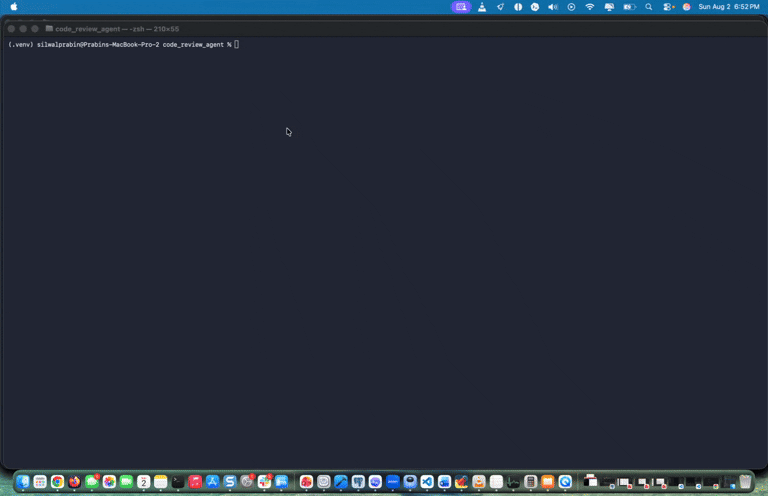

# GitHub Code Review Agent

> A local-first, multi-agent code reviewer. Point it at a repo and a team of
> specialist AI reviewers (security, performance, docs, testing) fan out across
> your code, then a lead reviewer synthesizes everything into one Markdown
> report — all powered by a model running on **your** machine via Ollama.



<!-- Replace docs/demo.gif with a short screen recording of a review run. -->

## Features

- **Multi-agent architecture.** A planner-style clone/list node fans work out to
  four independent **specialist** agents, and a **reviewer** agent fans the
  results back in.
  - `security` — hardcoded secrets, injection, unsafe patterns
  - `performance` — hot loops, complexity, wasted work
  - `docs` — missing docstrings, unclear names, absent type hints
  - `testing` — missing error handling, untested/edge-case-prone code
- **Structured findings.** Every specialist emits `file · line · severity · fix`
  bullets so the final report is consistent and actionable.
- **Local & private.** Uses [Ollama](https://ollama.com) — no code leaves your
  machine and there are no API bills.
- **Reviews URLs *or* local paths.** Pass a git URL to shallow-clone, or point
  at a directory to review it in place.
- **Optional GitHub integration.** Fetch repo metadata and post the review as an
  issue/PR comment when a `GITHUB_TOKEN` is configured.

## Architecture

The workflow is a [LangGraph](https://langchain-ai.github.io/langgraph/)
`StateGraph` with a fan-out / fan-in topology:

```
                        ┌────────────┐
                   ┌───▶│  security  │──┐
                   │    ├────────────┤  │
START ─▶ clone ────┼───▶│ performance│──┼──▶ reviewer ─▶ END
                   │    ├────────────┤  │
                   ├───▶│    docs    │──┤
                   │    ├────────────┤  │
                   └───▶│  testing   │──┘
                        └────────────┘
```

- **`clone` node** — resolves the `repo` value. If it is an existing directory
  it is reviewed in place; otherwise it is shallow-cloned with `git clone
  --depth 1`. It then lists the `*.py` files into shared state.
- **Specialist nodes** — built by a single `specialist(name, rubric)` factory.
  Each reads up to 8 files (a **tool call** via `read_file`), asks the local
  model to apply its rubric, and appends findings. Because `findings` is an
  `Annotated[list, operator.add]` field, the parallel specialists' outputs are
  merged automatically — that is the fan-in.
- **`reviewer` node** — groups findings by specialist, renders Markdown, and
  asks the model for an executive summary + overall severity.

Tools live in `src/tools.py` (`clone_repo`, `list_files`, `read_file`) and the
GitHub REST helpers in `src/github_api.py`.

## Quickstart

```bash
# 1. Pull a local model with Ollama (install Ollama first: https://ollama.com)
ollama pull llama3.2

# 2. Install Python dependencies (Python 3.12+)
pip install -r requirements.txt

# 3. (optional) configure environment
cp .env.example .env        # then edit values as needed

# 4. Review the bundled sample repo (default) ...
python main.py

# ... or a local path / git URL
python main.py ../../datasets/sample_repo
python main.py https://github.com/octocat/Hello-World
```

The review is written to `review.md`.

## Tech stack

| Layer            | Choice                                   |
| ---------------- | ---------------------------------------- |
| Orchestration    | LangGraph `StateGraph` (fan-out/fan-in)  |
| LLM runtime      | Ollama (`llama3.2` by default)           |
| HTTP / API       | `requests`                               |
| Config           | `python-dotenv`                          |
| VCS / cloning    | `git` (`gitpython` available)            |
| Tests            | `pytest`                                 |
| Packaging        | Docker + docker-compose                  |

## Testing

The tool layer is covered by offline unit tests (no network required):

```bash
pytest
```

## Configuration & secrets

Configuration is read from environment variables (optionally via `.env`):

- `OLLAMA_HOST` — Ollama base URL (default `http://localhost:11434`)
- `LLM_MODEL` — model name (default `llama3.2`)
- `GITHUB_TOKEN` — optional. Needed only for authenticated GitHub API calls
  (metadata, posting comments). **Put it in `.env` — never commit it.** The code
  reads it from the environment and never hard-codes a token.

## Docker

```bash
# Ollama runs on the host; the container reaches it via host.docker.internal.
docker compose up --build
```

`docker-compose.yml` sets `extra_hosts: host.docker.internal:host-gateway` and
loads secrets from `.env`.


## Your Instructor

**Er. Prabin Silwal**

- LinkedIn: <https://www.linkedin.com/in/prabin-silwal/>
- Instagram: <http://instagram.com/silwalprabin2023>
- Facebook: <https://www.facebook.com/Er.PrabinSilwal/>
- Website: <https://www.prabinsilwal.com.np/>
