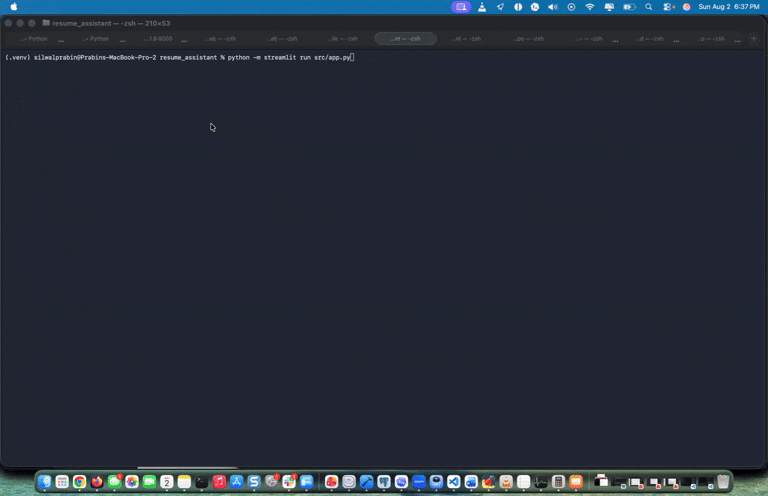

# 📄 AI Resume Assistant

**Beat the bots. Land the interview.** A 100% local, private RAG application
that scores your resume against any job description, tells you exactly which
skills you match and which you're missing, rewrites your bullet points, drafts
a tailored cover letter, and generates likely interview questions — all running
on your own machine with [Ollama](https://ollama.com). No data ever leaves
your laptop.



---

## ✨ Features

- **ATS score (0–100)** estimating how well your resume matches a job.
- **Matched vs. missing skills** extracted by an LLM acting as a recruiter.
- **Rewritten resume bullets** with stronger, quantified phrasing.
- **Tailored cover letter** generation.
- **Interview question generator** (technical + behavioural).
- **Downloadable Markdown report.**
- **Runs fully offline** — your resume never touches the cloud.

---

## 🏗️ Architecture — the RAG pipeline

```
PDF resume ──▶ read_pdf ──▶ chunk() ──▶ embed() ──▶ ChromaDB (vector store)
                                                            │
Job description ──▶ embed() ──▶ similarity search (top-k) ──┘
                                       │
                                       ▼
                        relevant resume excerpts (context)
                                       │
                                       ▼
             LLM (llama3.2 via Ollama) ── system: "expert technical recruiter"
                                       │
                                       ▼
                    structured JSON  ──▶  safe_json() parse (retry once)
                                       │
                                       ▼
        ATS score · matched/missing skills · bullets · cover letter · report
```

1. **Ingest** — `src/ingest.py` extracts text from the PDF (`pypdf`) and splits
   it into overlapping word windows.
2. **Embed & index** — `src/embeddings.py` embeds each chunk with
   `nomic-embed-text` and stores vectors in a persistent **ChromaDB**
   collection.
3. **Retrieve** — the job description is embedded and used to fetch the most
   relevant resume excerpts.
4. **Generate** — `src/rag.py` prompts `llama3.2` with that context and parses
   a strict JSON response, defensively retrying on malformed output so the app
   never crashes on bad LLM output.

---

## 🚀 Quickstart

```bash
# 1. Pull the models (one time)
ollama pull llama3.2
ollama pull nomic-embed-text

# 2. Install dependencies
pip install -r requirements.txt

# 3. (optional) configure environment
cp .env.example .env

# 4. Run the app
streamlit run src/app.py
```

Then open http://localhost:8501, upload a PDF resume, paste a job description,
and click **Analyze**.

### Optional REST API

```bash
uvicorn src.api:app --reload
# POST /analyze  { "resume": "...", "job": "..." }
```

### Docker

```bash
docker compose up --build
```

> When running in Docker, set `OLLAMA_HOST=http://host.docker.internal:11434`
> in your `.env` so the container can reach Ollama on the host. The provided
> `docker-compose.yml` already maps `host.docker.internal`.

---

## 🧰 Tech stack

| Layer         | Tool                              |
| ------------- | --------------------------------- |
| UI            | Streamlit                         |
| LLM runtime   | Ollama (`llama3.2`)               |
| Embeddings    | Ollama (`nomic-embed-text`)       |
| Vector store  | ChromaDB                          |
| PDF parsing   | pypdf                             |
| API           | FastAPI + Uvicorn                 |
| Orchestration | LangGraph / LangChain-Ollama      |
| Testing       | pytest                            |

---

## ✅ Testing

```bash
pytest
```

The ingestion tests (`tests/test_ingest.py`) run **without Ollama** — they only
exercise PDF reading and chunking against `data/sample_resume.pdf`.

---

## 🔒 Privacy

This project is **100% local and private**. Your resume and the job description
are processed entirely on your machine by Ollama. Nothing is sent to any
external API.

## Your Instructor

**Er. Prabin Silwal**

- LinkedIn: <https://www.linkedin.com/in/prabin-silwal/>
- Instagram: <http://instagram.com/silwalprabin2023>
- Facebook: <https://www.facebook.com/Er.PrabinSilwal/>
- Website: <https://www.prabinsilwal.com.np/>
